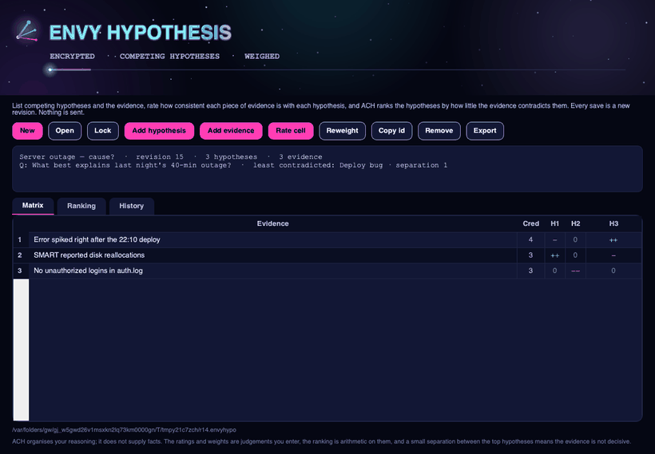
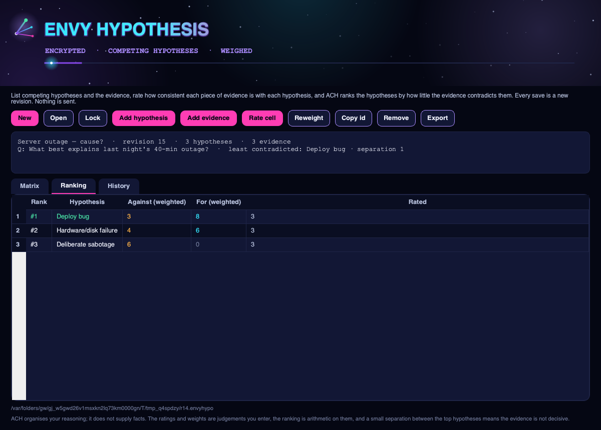

<p align="center">
  
</p>

<p align="center"><b>Lay out the competing explanations, rate how consistent each piece of evidence is with each one, and see which hypothesis the evidence least contradicts — the structured-analysis method (ACH), in a real native app window.</b><br />
AES-256-GCM encrypted analyses, a SHA-256 hash-chained event journal, revision-preserving saves, and plaintext export. From ENVY BLACK VEIL, as a standalone app.</p>

<p align="center">
  <a href="https://github.com/xzchick/envy-hypothesis/actions/workflows/tests.yml"></a>
</p>
<p align="center">
  
  
  <br />
  
  
  
  
  
</p>

<p align="center">
  <a href="#install"><b>Install</b></a> ·
  <a href="#works-on">Compatibility</a> ·
  <a href="#using-it">Using it</a> ·
  <a href="#honest-by-design">What it isn't</a> ·
  <a href="#build--test">Build</a>
</p>

<p align="center">
  
</p>

<p align="center"><sub>A real native window — not a browser view. The wordmark pulses, a premise forks into competing branches in the header, and a light travels the accent bar.</sub></p>

<a name="features"></a>




**Analysis of Competing Hypotheses** (ACH) is a structured-analysis method from intelligence tradecraft, by Richards Heuer. Instead of finding reasons to believe your favourite answer, you list *all* the plausible explanations, gather the evidence once, and test every piece against every hypothesis — then keep the hypothesis the evidence *least contradicts*. You disprove rather than confirm.

In ENVY Hypothesis you write the key **question**, add the competing **hypotheses**, add the **evidence** (each with a credibility weight from 1 to 5), and rate each **cell** of the matrix from *very inconsistent* (−2) to *very consistent* (+2). The analysis is sealed in the same **AES-256-GCM** envelope [ENVY Vault](https://github.com/xzchick/envy-vault) uses.

<p align="center">
  
</p>

The score ranks the hypotheses by **weighted inconsistency** — the credibility-weighted sum of the evidence *against* each one — and shows the least-contradicted first, with the **separation** to the runner-up so you can see whether the evidence is actually decisive. It also flags which evidence is **diagnostic** (it discriminates between hypotheses) and which is consistent with everything and so decides nothing. Every change is appended to a **SHA-256 hash-chained journal**, and every save is a new revision; the previous one is never overwritten. A plaintext HTML or JSON report can be exported whenever you choose. Everything is local.

<a name="works-on"></a>


<p align="center">
  
  
  
</p>



### Requirements

| | 🍎 macOS | 🪟 Windows | 🐧 Linux |
|---|---|---|---|
| **OS version** | macOS 11 Big Sur or newer | Windows 10 or 11 (64-bit) | A current x86_64 or arm64 desktop |
| **Standalone bundle** | Nothing else to install | Nothing else to install | Standard desktop libraries (X11 or Wayland) |
| **From pip** | Python 3.10+ | Python 3.10+ | Python 3.10+ and a desktop session |
| **Dependencies** | `cryptography` + Qt (bundled) | `cryptography` + Qt (bundled) | `cryptography` + Qt (bundled) |
| **Network** | None, ever | None, ever | None, ever |

<a name="install"></a>


A **standalone bundle** that needs no Python, or **pip** if you already have Python 3.10+.

### Standalone bundle (no Python)

Download a bundle from the [latest release](https://github.com/xzchick/envy-hypothesis/releases/latest):

| File | System | Run it |
|---|---|---|
| `envy-hypothesis-v0.1.0-macos-arm64.tar.gz` | macOS (Apple Silicon) | `tar -xzf` it, then open `envy-hypothesis` |
| `envy-hypothesis-v0.1.0-windows-x86_64.zip` | Windows (64-bit) | Unzip, then run `envy-hypothesis.exe` |
| `envy-hypothesis-v0.1.0-linux-x86_64.tar.gz` | Linux (64-bit) | `tar -xzf` it, then run `./envy-hypothesis` |
| `envy_hypothesis-0.1.0-py3-none-any.whl` | Any OS with Python 3.10+ | `pip install` the wheel |
| `SHA256SUMS.txt` | — | Verify your download first |

Running `envy-hypothesis` with no arguments opens the window.

### From pip (Python 3.10+)

```sh
git clone https://github.com/xzchick/envy-hypothesis.git
cd envy-hypothesis
python3 -m venv .venv
. .venv/bin/activate          # Windows: .venv\Scripts\activate
pip install .
envy-hypothesis                # opens the window
```

<a name="using-it"></a>


**In the window**

- **New** → name the analysis and its key question, set a passphrase (at least 12 characters).
- **Add hypothesis** → each competing explanation. **Add evidence** → each item, with a credibility of 1–5.
- In the **Matrix** tab, click a cell where an evidence row meets a hypothesis column, then **Rate cell** from very inconsistent to very consistent.
- **Ranking** tab → the hypotheses ordered by how little the evidence contradicts them. **Remove** drops the selected hypothesis or evidence.
- **Export** → writes a plaintext HTML or JSON report.

**In the terminal**

```sh
envy-hypothesis init outage.envyhypo --title "Outage" --question "Why was the service down?"
envy-hypothesis hypothesis outage.envyhypo o.r1.envyhypo --label "Routine failure"
envy-hypothesis evidence o.r1.envyhypo o.r2.envyhypo --text "No signs of intrusion" --credibility 3
envy-hypothesis rate o.r2.envyhypo o.r3.envyhypo --evidence <id> --hypothesis <id> --value very-inconsistent
envy-hypothesis score o.r3.envyhypo              # least-contradicted ranking
envy-hypothesis export o.r3.envyhypo report.html --format html
```

Every write is a new file; the analysis is never overwritten. `score` and `matrix` read without changing anything.

<a name="honest-by-design"></a>


The analysis and its journal are sealed with **AES-256-GCM** and a key derived from your passphrase with **scrypt**, and the event journal is **hash-chained** so changes cannot be reordered or edited without breaking the chain. What Hypothesis does **not** do is just as important:

- **It supplies no facts.** ACH organises *your* reasoning. The hypotheses, the evidence, the credibility weights and every rating are judgements you enter; the ranking is arithmetic on them.
- **A small separation is not a verdict.** When the top hypotheses are close, the evidence is not decisive — that is a finding, not a failure. The score reports the separation so you can see it.
- **Garbage in, garbage out.** A rating is only as good as your honesty about the evidence, and a hypothesis you never wrote down can never win. List the explanations you would rather not consider.
- **Diagnostic evidence is what matters.** Evidence consistent with every hypothesis decides nothing, however true it is; the score flags it so you can set it aside and look for evidence that actually discriminates.
- **Nothing is sent.** No network, no accounts. Every result is a new local file; times come from your clock.

> [!IMPORTANT]
> Keep your passphrase safe. There is no recovery: without it, an encrypted analysis cannot be opened.

<a name="build--test"></a>


```sh
python -m unittest discover -s tests -v          # unit tests (no display needed)
pip install pyinstaller build
python scripts/build_release_bundle.py           # standalone bundle + wheel + sdist + checksums
python scripts/smoke_test_release.py             # launch the built bundle and check it runs
```

CI runs all of this on Ubuntu, Windows and macOS for every push. Regenerate the README artwork with `python scripts/render_readme_art.py`.

<p align="center"><sub>MIT licensed. Part of ENVY BLACK VEIL, packaged as a standalone app. Offline; no telemetry, no network, no accounts.</sub></p>
